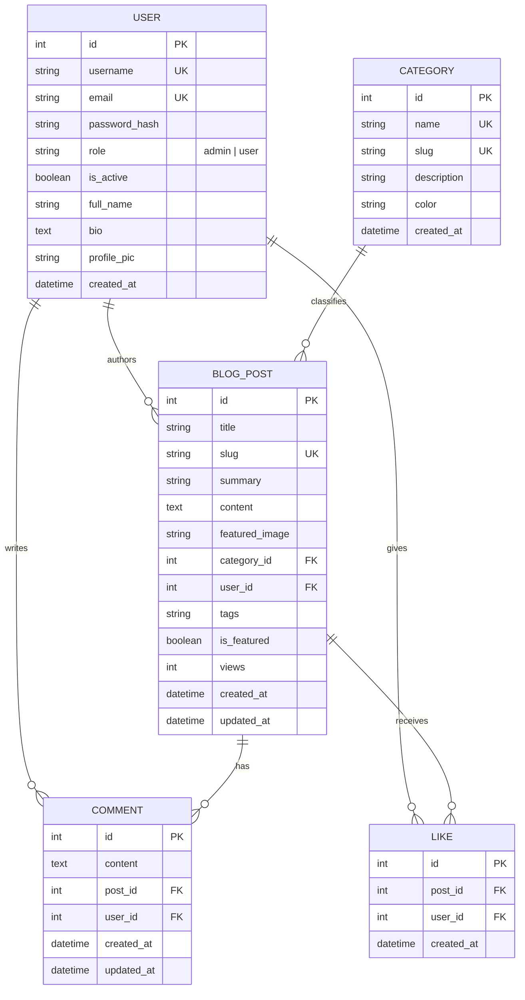

# BlogSphere – Full-Stack Blog Platform with Comments

A modern, responsive, secure, and production-ready full-stack blogging platform built with **Python Flask**, **SQLite**, **Flask-SQLAlchemy**, **Flask-Login**, and **Bootstrap 5**.

Developed as an academic capstone and college assignment titled **Blog Platform with Comments**.

---

## 🌟 Key Highlights & Design

- **Modern Clean UI**: Styled with a contemporary light theme featuring slate typography, subtle multi-layered elevations, responsive grid layouts, and an indigo/purple brand palette (`#4f46e5` / `#7c3aed`).
- **Complete Authentication & RBAC**: Scrypt password hashing, session management, CSRF defense, and strict dual-role permission gating (**Admin** and **Normal User**).
- **Interactive Engagement**: AJAX-powered like/unlike mechanics with live counters, in-place comment editing modals, and universal delete confirmation dialogs.
- **Content Discovery**: Multi-field search across titles, summaries, bodies, and tags, alongside category filtering, multi-criteria sorting (latest, popular, views, oldest), and pagination.
- **RESTful API**: Clean JSON endpoints supporting GET, POST, PUT/PATCH, and DELETE operations for seamless headless integration or testing.
- **100% Automated Test Suite**: Comprehensive unit and integration test suite covering authentication, permissions, CRUD, comments, likes, search, and REST APIs.

---

## 🛠️ Technology Stack

| Layer | Technology | Details |
| :--- | :--- | :--- |
| **Backend Framework** | [Python Flask 3.x](https://flask.palletsprojects.com/) | WSGI application factory pattern with modular blueprints |
| **Database** | [SQLite 3](https://sqlite.org/) | Embedded relational SQL database |
| **ORM** | [Flask-SQLAlchemy 3.x](https://flask-sqlalchemy.palletsprojects.com/) | Declarative relational models, foreign keys, cascading deletes |
| **Authentication** | [Flask-Login](https://flask-login.readthedocs.io/) | Secure session management & user loader |
| **Security & Hashing** | [Werkzeug](https://palletsprojects.com/p/werkzeug/) | Scrypt password hashing, secure filename sanitization |
| **Form Handling & CSRF** | [Flask-WTF](https://flask-wtf.readthedocs.io/) & [WTForms](https://wtforms.readthedocs.io/) | Server-side form validation, CSRF tokens, file filters |
| **Frontend UI** | [Bootstrap 5.3](https://getbootstrap.com/) | Fully responsive grid, cards, modals, and navbars |
| **Icons** | [Bootstrap Icons 1.11](https://icons.getbootstrap.com/) | Vector icons for all UI elements and interactions |
| **Typography** | [Inter Google Font](https://fonts.google.com/specimen/Inter) | Clean readability across all screen sizes |
| **WSGI Server** | [Gunicorn](https://gunicorn.org/) | Production HTTP server configuration |

---

## 📐 Database Schema & Architecture



---

## 📁 Project Folder Structure

```
Blog-Platform/
│
├── app.py                     # Main Flask application & routes (Web + REST API)
├── config.py                  # Environment & deployment configurations
├── models.py                  # SQLAlchemy database models & relationship logic
├── forms.py                   # WTForms form classes & server-side validation
├── seed.py                    # Database seeding CLI script (categories, users, posts)
├── wsgi.py                    # Production WSGI application entry point
├── requirements.txt           # Pinned Python package dependencies
├── Procfile                   # Deployment process file for Render / Heroku
├── README.md                  # Comprehensive documentation & setup guide
├── .env.example               # Environment variables template
├── .gitignore                 # Version control exclusions
│
├── templates/                 # Jinja2 HTML Templates
│   ├── base.html              # Base layout (Navbar, Footer, Modals, Flash alerts)
│   ├── index.html             # Homepage (Hero, Featured, Latest, Categories)
│   ├── blogs.html             # All blogs listing (Search, Filters, Sorting, Pagination)
│   ├── blog_detail.html       # Single article view, comments, likes, author card
│   ├── create_blog.html       # Article creation form with instant image preview
│   ├── edit_blog.html         # Article editing form with authorization check
│   ├── dashboard.html         # User dashboard with engagement metrics
│   ├── my_blogs.html          # User's blog management table
│   ├── my_comments.html       # User's comments management table
│   ├── profile.html           # Profile settings & password change tab
│   ├── admin_dashboard.html   # Admin portal (Users, Posts, Comments, Categories)
│   ├── about.html             # About Us page
│   ├── contact.html           # Contact Us page with inquiry form & FAQ
│   └── errors/                # Custom Error Handlers
│       ├── 403.html           # Forbidden / Unauthorized error page
│       ├── 404.html           # Page Not Found error page
│       └── 500.html           # Internal Server Error page
│
├── static/
│   ├── css/
│   │   └── style.css          # Custom styling, animations, colors, shadows
│   ├── js/
│   │   └── script.js          # AJAX likes, comment editing, modal listeners
│   ├── images/
│   │   ├── default-avatar.svg # Default author avatar SVG graphic
│   │   └── default-blog.svg   # Default blog cover illustration SVG graphic
│   └── uploads/               # User-uploaded cover images and avatars
│       └── .gitkeep
│
├── instance/
│   ├── blog.db                # SQLite database file (created automatically)
│   └── .gitkeep
│
└── tests/
    └── test_app.py            # Automated test suite (13 comprehensive tests)
```

---

## ⚡ Quick Start & Installation (Windows PowerShell)

Follow these exact commands to install dependencies, seed the database, and launch the application locally.

### 1. Open Terminal in the Project Directory
```powershell
cd c:\Users\ashir\OneDrive\Desktop\Blog-Platform
```

### 2. (Optional) Create and Activate a Virtual Environment
```powershell
python -m venv .venv
.\.venv\Scripts\Activate.ps1
```

### 3. Install Required Dependencies
```powershell
pip install -r requirements.txt
```

### 4. Seed the Database with Realistic Sample Data
```powershell
python seed.py
```
> This creates the SQLite tables, 6 categories, 4 realistic users, 6 articles, 9 comments, and 14 likes.

### 5. Start the Development Server
```powershell
python app.py
```

### 6. Open in Browser
Visit **[http://127.0.0.1:5000](http://127.0.0.1:5000)** in your web browser.

---

## 🔑 Default Test Accounts & Credentials

The seed script creates the following pre-configured credentials for testing and evaluation:

| Role | Username | Email | Password | Permissions |
| :--- | :--- | :--- | :--- | :--- |
| **Administrator** | `admin` | `admin@blogsphere.com` | `Admin@123` | Full access: user management, category management, post & comment moderation. |
| **Standard User 1** | `alex_dev` | `alex@example.com` | `Alex@123` | Create, edit, delete own posts; comment; like posts. |
| **Standard User 2** | `sarah_connor` | `sarah@example.com` | `Sarah@123` | Create, edit, delete own posts; comment; like posts. |
| **Standard User 3** | `elena_ux` | `elena@example.com` | `Elena@123` | Create, edit, delete own posts; comment; like posts. |

---

## 🧪 Running Automated Tests

Run the full test suite using Python's built-in `unittest` runner:

```powershell
python -m unittest tests/test_app.py
```

Or using `pytest`:
```powershell
pytest -v tests/test_app.py
```

### Test Coverage Highlights:
- User registration with email format validation.
- Duplicate email and duplicate username prevention.
- User login, session retention, and logout.
- Blog post creation, viewing, slug generation.
- Blog post editing by author and prevention of unauthorized edits.
- Blog post deletion and cascade to comments/likes.
- Comment posting, inline editing, and deletion.
- AJAX like and unlike toggle mechanics.
- Keyword search and category filtering.
- Admin dashboard route protection (`403 Forbidden` for non-admins).
- REST API lifecycle: `/api/login`, `/api/posts` creation, single post retrieval, and liking.

---

## 🌐 RESTful API Documentation

All API endpoints return standard JSON responses and status codes. API endpoints (`/api/*`) are exempt from CSRF token requirements, making them accessible to tools like Postman, curl, and frontend fetch clients.

### 1. Authentication Endpoints

#### `POST /api/register`
Create a new user account.
- **Request Body**:
  ```json
  {
    "username": "coder123",
    "email": "coder@example.com",
    "password": "Password123",
    "full_name": "John Coder"
  }
  ```
- **Response**: `201 Created`

#### `POST /api/login`
Authenticate and obtain a session.
- **Request Body**:
  ```json
  {
    "email_or_username": "coder@example.com",
    "password": "Password123"
  }
  ```
- **Response**: `200 OK`

#### `POST /api/logout`
End current authenticated session.
- **Response**: `200 OK`

#### `GET /api/me`
Retrieve currently authenticated user profile.
- **Response**: `200 OK` or `401 Unauthorized`

---

### 2. Blog Posts Endpoints

#### `GET /api/posts`
Fetch paginated list of blog posts.
- **Query Parameters**:
  - `page` (optional, default: 1)
  - `per_page` (optional, default: 10)
  - `search` (optional keyword)
  - `category` (optional category slug)
- **Response**: `200 OK`
  ```json
  {
    "page": 1,
    "pages": 1,
    "total": 6,
    "posts": [ ... ]
  }
  ```

#### `GET /api/posts/<id>`
Fetch complete blog post details including full content.
- **Response**: `200 OK`

#### `POST /api/posts`
Create a new blog post (*Requires Authentication*).
- **Request Body**:
  ```json
  {
    "title": "New Article on AI",
    "category_id": 1,
    "summary": "Short overview...",
    "content": "Full article markdown or text...",
    "tags": "ai, technology"
  }
  ```
- **Response**: `201 Created`

#### `PUT /api/posts/<id>`
Update an existing blog post (*Author or Admin only*).
- **Response**: `200 OK` or `403 Forbidden`

#### `DELETE /api/posts/<id>`
Delete a blog post (*Author or Admin only*).
- **Response**: `200 OK` or `403 Forbidden`

---

### 3. Comments Endpoints

#### `GET /api/posts/<id>/comments`
Fetch all comments for a specific post.
- **Response**: `200 OK`

#### `POST /api/posts/<id>/comments`
Add a comment to an article (*Requires Authentication*).
- **Request Body**:
  ```json
  {
    "content": "Great article! Really enjoyed the architectural tips."
  }
  ```
- **Response**: `201 Created`

#### `DELETE /api/comments/<id>`
Delete a comment (*Comment Author or Admin only*).
- **Response**: `200 OK` or `403 Forbidden`

---

### 4. Likes & Categories Endpoints

#### `POST /api/posts/<id>/like`
Toggle like or unlike for a post (*Requires Authentication*).
- **Response**: `200 OK`
  ```json
  {
    "liked": true,
    "post_id": 1,
    "total_likes": 15
  }
  ```

#### `GET /api/categories`
Fetch all available blog categories.
- **Response**: `200 OK`

---

## 🔒 Security Best Practices Implemented

1. **Scrypt Password Hashing**: Passwords are never stored in plain text. Werkzeug generates salted scrypt hashes.
2. **CSRF Defense**: All web forms are protected with `Flask-WTF` CSRF tokens, preventing cross-site request forgery.
3. **Role-Based Access Control**:
   - Standard users can only modify their own posts and comments.
   - Administrative routes (`/admin`, user toggles, category creation) are guarded with the `@admin_required` decorator.
4. **Defensive File Uploads**:
   - Uploaded files are inspected for allowed extensions (`.jpg`, `.jpeg`, `.png`, `.webp`, `.gif`).
   - Filenames are sanitized via `secure_filename` and assigned unique UUID timestamps to prevent directory traversal or file overwrites.
   - Max file size is capped at 8MB (`MAX_CONTENT_LENGTH`).
5. **SQL Injection Immunity**: All database queries utilize SQLAlchemy parameterized queries and ORM objects.
6. **XSS Protection**: Jinja2 auto-escapes user input. Where user-formatted linebreaks are rendered, HTML is sanitized.

---

## 🚀 Production Deployment Guide (Render / Cloud)

### Deploying to Render

1. **Push Code to GitHub**:
   ```bash
   git init
   git add .
   git commit -m "Initial commit of BlogSphere platform"
   git branch -M main
   git remote add origin https://github.com/your-username/blogsphere.git
   git push -u origin main
   ```

2. **Create a New Web Service on Render**:
   - Link your GitHub repository.
   - **Environment**: `Python 3`
   - **Build Command**: `pip install -r requirements.txt`
   - **Start Command**: `gunicorn wsgi:application`

3. **Configure Environment Variables in Render Dashboard**:
   - `FLASK_ENV`: `production`
   - `SECRET_KEY`: A secure random string (generate with `python -c "import secrets; print(secrets.token_hex(32))"`)
   - `WTF_CSRF_SECRET_KEY`: Another secure random string.

4. **Persistent Storage Considerations**:
   - **Database**: In production, SQLite files on ephemeral containers reset upon restart. For persistent production data, add a free Render PostgreSQL database and set the `DATABASE_URL` environment variable (BlogSphere automatically supports PostgreSQL connections out of the box).
   - **Image Uploads**: On free container tiers with ephemeral filesystems, upload directories are wiped during restarts. For production scale, attach a Render Persistent Disk mounted to `static/uploads`, or integrate AWS S3 / Cloudinary.

---

## 📄 License & Academic Attribution

This project is submitted as an academic assignment for **Blog Platform with Comments**. Designed, architected, and built with modern full-stack web engineering standards.
